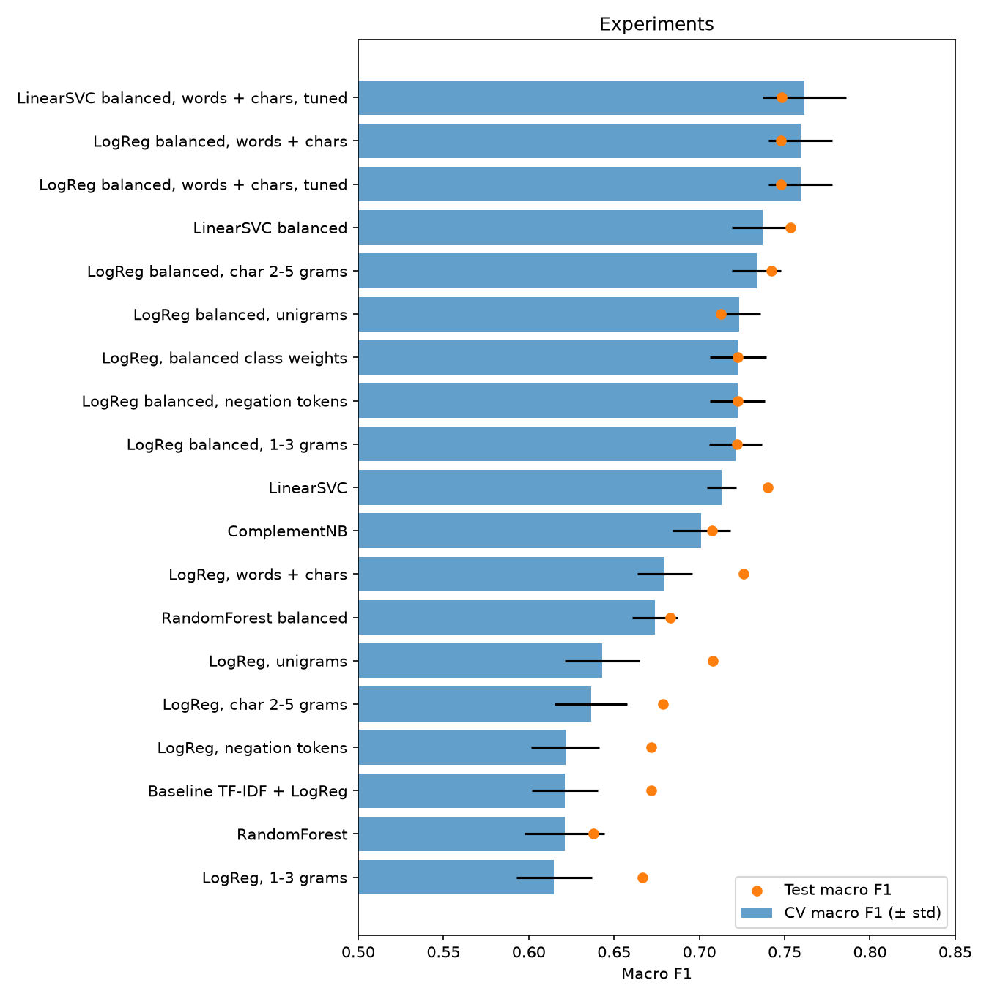
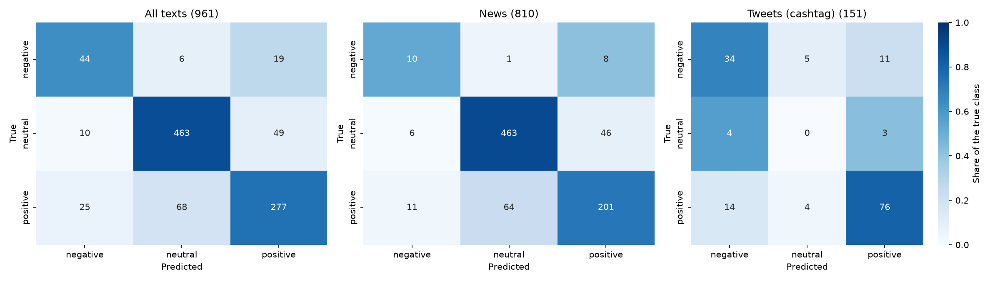

# itg-classification

Sentiment classification of financial news and tweets as a small ML
product: it loads the data, cleans the texts, trains and compares
models, analyzes the errors and classifies new texts.

```
$ make predict TEXT="Nokia raised its sales forecast after a strong quarter"
positive  0.94  Nokia raised its sales forecast after a strong quarter
```

## Task

Three-class sentiment of a short financial text: `negative`,
`neutral` or `positive`. The classes are imbalanced, so the main metric
is **macro F1**, the mean F1 over the classes: a model that always says
`neutral` gets 54% accuracy but only 0.23 macro F1.

## Dataset

Kaggle [Financial Sentiment Analysis](https://www.kaggle.com/datasets/sbhatti/financial-sentiment-analysis),
in `data/raw/financial_sentiment.csv`: 5,842 English sentences. It mixes
two sources: Financial PhraseBank news sentences (`Ruukki 's order book
...`) and FiQA tweets with cashtags (`$TSLA ...`).

| Class | Raw | After preprocessing |
|---|---|---|
| neutral | 3,130 | 2,610 (54%) |
| positive | 1,852 | 1,850 (39%) |
| negative | 860 | 343 (7%) |

514 texts appear twice with the labels `negative` and `neutral`. Both
copies are dropped, which leaves 4,803 rows (see
[Limitations](#limitations) for the cost of this decision).

## Quick start

Python 3.13 and [uv](https://docs.astral.sh/uv/).

```bash
uv sync             # install dependencies
make pipeline       # preprocess, split, train, analyze (~1 min)
make demo           # the saved model on hand-written examples
make predict TEXT="Sales rose 20% year-on-year"
```

## Training

`make pipeline` runs the whole flow. Every step can also run alone:

| Step | Command | Output |
|---|---|---|
| Clean texts, drop bad rows, encode labels | `make preprocess` | `data/processed/financial_sentiment.csv` |
| Stratified 80/20 split | `make split` | `data/processed/train.csv`, `test.csv` |
| Baseline: TF-IDF + LogReg | `make train-baseline` | `models/baseline.joblib`, `results/baseline_*` |
| 19 experiments, choose the best by 5-fold CV | `make train-improved` | `models/best_model.joblib` + model card, `results/comparison.md` |
| Error analysis of the best model | `make error-analysis` | `results/error_analysis.txt`, `results/errors.csv` |

Models are chosen by cross-validation on train only. The test set (961
texts) is used for the final scores, never for choices.

## Usage

The saved best model classifies new texts without retraining. Train it
once with `make pipeline`, and again after changing the code or
scikit-learn.

### From Python

```python
from itg_classification.predict import load_model, predict

model = load_model()  # load once, reuse for every call
predictions = predict(["Sales rose 20% year-on-year", "http://t.co/x"], model)
predictions[0].label  # "positive"
predictions[0].confidence  # 0.94
predictions[0].to_dict()  # plain dict for JSON
```

### From the command line

```bash
$ make predict TEXT="Sales rose 20% year-on-year"
positive  0.94  Sales rose 20% year-on-year

$ uv run itg-classification "The board will meet on Monday" '$NFLX looks weak more bleeding'
neutral   0.79  The board will meet on Monday
negative  0.51  $NFLX looks weak more bleeding  (low confidence)

$ uv run itg-classification --json "Sales rose"        # one JSON object per line
$ uv run itg-classification --threshold 0.7 "Sales rose"
```

### A CSV file

```bash
make predict-file INPUT=news.csv OUTPUT=predictions.csv
uv run itg-classification --input news.csv --output predictions.csv --column headline
```

### Input

| | |
|---|---|
| Python | a string or a list of strings |
| Command line | one or more texts as arguments, or `--input` with a CSV |
| CSV | a `text` column (another one with `--column`), other columns are ignored |
| Language | English financial news or tweets, raw: links, mentions, `RT`, hashtags and spacing are cleaned by the same `preprocess_text` as the training data |

### Output

One prediction per input text, in the same order:

| Field | Type | Meaning |
|---|---|---|
| `text` | string | the input text, unchanged |
| `label` | `negative` / `neutral` / `positive` or none | the predicted sentiment |
| `confidence` | 0-1 or none | probability of the predicted label |
| `probabilities` | label → 0-1 | all three probabilities, they sum to 1; in CSV the columns `p_negative`, `p_neutral`, `p_positive` |
| `low_confidence` | bool | `confidence` below 0.6: the model is right on about 57% of such test texts, against 90% above |
| `error` | string or none | why the text got no label |

### Errors

| Situation | What happens |
|---|---|
| A text has no letters after preprocessing (empty, a bare link, only numbers) | no label, `error` is `no words to classify after preprocessing`, the other texts are classified |
| A text is not a string | `TypeError` |
| The model is not trained | `ModelError`, the command line prints it and exits with code 1 |
| The model was trained with another scikit-learn | `ModelError`: retrain with `make train-improved` |
| The CSV has no text column | `ValueError`, exit code 1 |

## Results

Macro F1 on the same 961 test texts:

| Model | CV macro F1 | Test macro F1 | Accuracy | Negative recall |
|---|---|---|---|---|
| Always `neutral` | | 0.235 | 0.543 | 0.000 |
| Baseline: TF-IDF words 1-2 + LogReg | 0.621 | 0.672 | 0.795 | 0.261 |
| **Best: + balanced class weights + character 2-5 grams** | **0.759** | **0.748** (+11.3%) | 0.816 | 0.638 |



**Why the best model is better:**

- **Class weights** make an error on the 7% `negative` class cost 4.7
  times an average one: `negative` recall 0.26 → 0.64.
- **Character n-grams** match word forms, tickers and slang in tweets:
  accuracy on tweets 0.63 → 0.73, on news unchanged.
- Tuning `C`, trigrams, negation tokens, LinearSVC, ComplementNB and
  RandomForest did not beat it. LinearSVC tied, LogReg won the tie with
  probabilities and a higher `negative` recall.

**Error analysis** of the best model (177 errors of 961):



- Two thirds of the errors are `positive` ↔ `neutral` in news: business
  events like *will open 20 new stores* are labeled `positive` without
  any evaluative word.
- Tweets fail on `negative` ↔ `positive`: slang (*more bleeding*),
  negation (*won't stay down*) and memorized tickers.
- The confidence is meaningful: 99% accuracy above 0.9, 42% at 0.5 or
  below.

Details: [REPORT.md](REPORT.md), notebooks `02`-`04`,
[results/](results/).

## Demo

```
$ make demo
  kind                  expected  predicted  conf.  text
✓ news                  positive  positive   0.90   Nokia raised its full-year sales forecast after a strong third quarter.
✓ news                  neutral   neutral    0.95   The annual general meeting will be held on 15 March in Helsinki.
✗ news                  negative  positive   0.92   Operating profit fell to EUR 3.1 million from EUR 7.8 million a year earlier.
✓ tweet                 negative  negative   0.90   $NFLX looks weak, adding to my short
✗ hard: negation        positive  neutral    0.81   Results were not as bad as analysts feared.
✗ hard: mixed           neutral   positive   0.50   Sales rose in Sweden but fell in Finland. (low confidence)
✓ no words              -         -                 http://stks.co/abc
...
10 of 15 as expected
```

The 15 examples are in [demo/examples.csv](demo/examples.csv), add your
own rows to try more. More on new texts and edge cases:
[notebooks/05_inference.ipynb](notebooks/05_inference.ipynb).

## Limitations

- **Negative news is unreliable.** Dropping the conflicting texts
  removed 514 of 642 negative news sentences, all like *net profit
  decreased*. In train `fell` and `decreased` never appear in a
  `negative` text, so *Operating profit fell* is `positive` with 0.92
  confidence, and the `low_confidence` flag does not catch it. Keeping
  one `negative` copy of every conflicting text is the first fix to try.
- **Negation and mixed sentences:** *not as bad as feared*, *rose in
  Sweden but fell in Finland*. A bag-of-words model does not see word
  order.
- **Business events** without evaluative words (contracts, new stores)
  are often `neutral` instead of `positive`; half of the confident
  errors here have debatable labels. This is a ceiling for word counts.
- **Tweets:** the model partly memorizes tickers (38% errors when a
  tweet goes against its ticker's usual sentiment, 13% otherwise) and
  got none of 7 `neutral` test tweets right.
- **English only.** A text in another language still gets a label,
  which means nothing.
- **Small test set:** 69 `negative` texts, one error moves their recall
  by 1.5 points. Differences below 0.02 macro F1 are noise.
- **When to trust it:** a prediction flagged `low_confidence` (below
  0.6) is right on about 57% of test texts, an unflagged one on 90%.

## Project structure

```
data/raw/                     raw dataset
data/processed/               preprocessed dataset, train and test
demo/examples.csv             hand-written demo texts
figures/                      saved plots
models/                       trained models and model cards (not in git)
notebooks/
    00_eda.ipynb              exploratory data analysis
    01_preprocessing.ipynb    manual check of the preprocessing
    02_baseline.ipynb         baseline results and what it learned
    03_improvements.ipynb     experiments, the best model and why
    04_error_analysis.ipynb   where and why the best model fails
    05_inference.ipynb        the saved model on new texts
results/                      metrics, comparison, error analysis
src/itg_classification/
    config.py                 paths, labels and shared settings
    load_data.py              dataset loading and validation
    eda.py                    EDA helpers and plots
    preprocess.py             text cleaning, filtering, label encoding
    split.py                  train/test split
    features.py               word and character TF-IDF, top features
    train_baseline.py         baseline training
    train_improved.py         experiments, grid search, best model
    metrics.py                metrics, reports, comparison table
    error_analysis.py         errors, failure cases, report
    predict.py                inference: load the model, predict, CLI
    demo.py                   demo on demo/examples.csv
tests/                        pytest tests
REPORT.md                     development report, day by day
```

## Development

| Command | What it does |
|---|---|
| `make test` | Run the tests |
| `make lint` / `make format` | Check / format the code with ruff |
| `make fix` | Fix lint errors and format the code |
| `make typecheck` | Type check with ty |
| `make check` | All of the above, with a short report |
