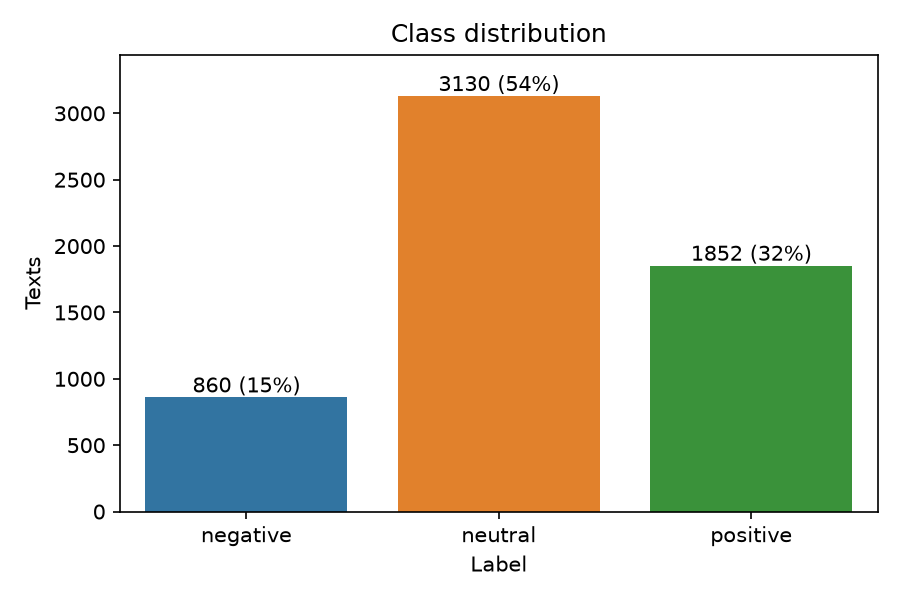
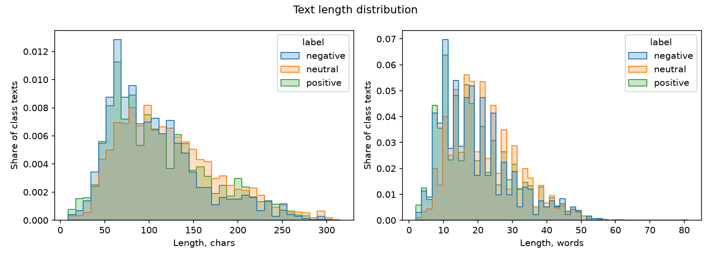
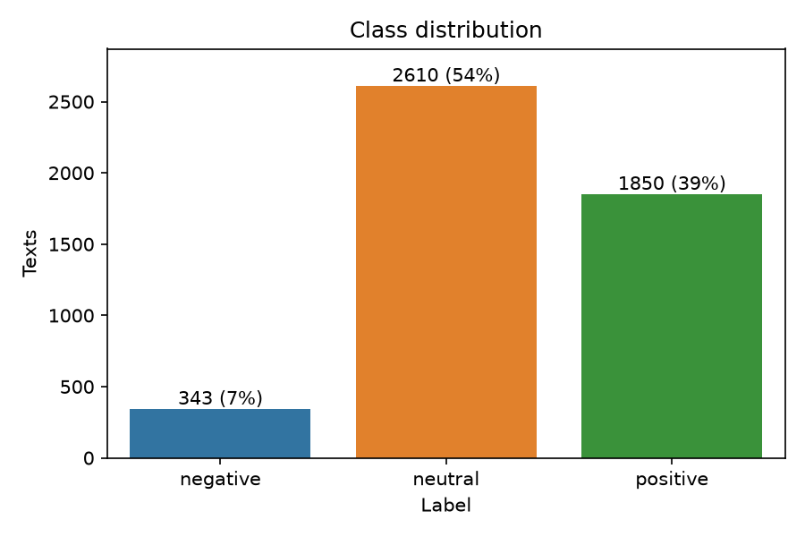
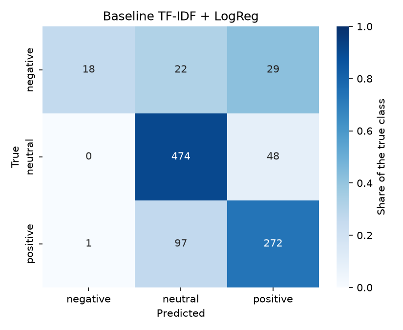
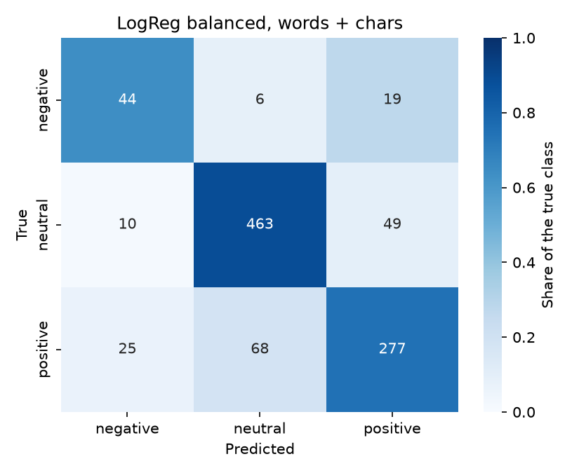
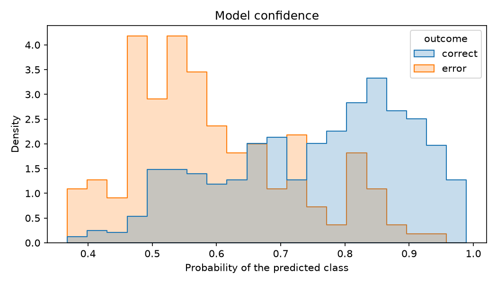

# Development report

How the project was built, day by day: what was tried, the numbers and
the decisions. The short version is in the [README](README.md).

## Day 1: data overview

Details and plots are in [notebooks/00_eda.ipynb](notebooks/00_eda.ipynb).

| | |
|---|---|
| Rows | 5,842 |
| Columns | `text`, `label` (strings, no missing values) |
| Classes | `neutral` 54%, `positive` 32%, `negative` 15% |
| Text length | median 19 words, at most 81 |





Findings:

- **Label conflicts.** 514 texts appear twice, once as `negative` and
  once as `neutral`: 60% of all `negative` rows. They must be resolved
  before the train/test split.
- **Class imbalance** of 3.6 : 1. A constant `neutral` prediction gets
  54% accuracy, so the main metric is macro F1 and the split is
  stratified.
- **Two sources.** Tokenized news sentences (`Ruukki 's`, `30 %`) and
  tweets with cashtags (`$TSLA`), links and slang.
- **Source shortcut.** Cashtags occur in about a quarter of `negative`
  and `positive` texts but in 1% of `neutral` ones, so a model can learn
  "cashtag means not neutral".

## Day 2: preprocessing

Code in [preprocess.py](src/itg_classification/preprocess.py), manual
check in [notebooks/01_preprocessing.ipynb](notebooks/01_preprocessing.ipynb).

`preprocess_text` is the single text transformation, shared by training
and inference:

1. `clean_text` drops links, the `RT` marker and @mentions, keeps the
   word of a hashtag and keeps cashtags.
2. `normalize_text` lowercases, drops quotes and undoes the news
   tokenization: `Ruukki 's` → `ruukki's`, `30 %` → `30%`,
   `( ADP )` → `(adp)`.

| Before | After |
|---|---|
| `RT @bman1 $LNG looks primed also` | `$lng looks primed also` |
| `( ADP News ) - Feb 11 , 2009` | `(adp news) - feb 11, 2009` |
| `Financial details were n't disclosed .` | `financial details weren't disclosed.` |

`preprocess_dataset` then filters the rows and encodes the labels
(`negative` 0, `neutral` 1, `positive` 2):

| Filter | Removed rows |
|---|---|
| empty after cleaning | 0 |
| no letters | 0 |
| conflicting labels: every copy of a text with two labels | 1,028 |
| duplicates | 11 |

5,842 rows → 4,803. The processed CSV keeps the original text in
`raw_text` for the error analysis.



Dropping the conflicts leaves `negative` at 7%, the imbalance grows
from 3.6 : 1 to 7.6 : 1. The models will need class weights.

Broken encodings like `L+ñnnen` (2% of texts, mostly names) are kept:
the original letters are lost and cannot be restored.

## Day 3: baseline

```bash
make preprocess && make split && make train-baseline
```

- **Split:** stratified 80/20, `random_state=42`: 3,842 train and 961
  test rows with the same class shares. The split is saved, so every
  model is scored on the same test set.
- **Model:** one sklearn `Pipeline` of `TfidfVectorizer` (words and
  bigrams, `min_df=2`, 11k features) and `LogisticRegression` with
  default settings. The vectorizer is fitted on train only.
- **Saved:** `models/baseline.joblib`,
  [results/baseline_metrics.json](results/baseline_metrics.json),
  [results/baseline_report.txt](results/baseline_report.txt).

Details in [notebooks/02_baseline.ipynb](notebooks/02_baseline.ipynb).

| Model | Macro F1 | Accuracy | Weighted F1 | Negative recall |
|---|---|---|---|---|
| Majority class | 0.235 | 0.543 | 0.382 | 0.000 |
| **Baseline TF-IDF + LogReg** | **0.672** | 0.795 | 0.783 | 0.261 |



- `negative` is the weak class: precision 0.95, recall 0.26. Without
  class weights the model predicts it only when it is very sure.
- Missed `negative` texts go to `positive` more often than to
  `neutral`. 50 of the 69 `negative` test texts are tweets, and the
  model is right on 63% of tweets against 83% of news sentences.
- The strongest `negative` features include tickers and company names
  (`tsla`, `spy`, `aapl`, `tesco`), the strongest `neutral` ones are
  function words (`the`, `is`, `of`): the model partly learns companies
  and text style, not sentiment.

**Reference point:** macro F1 **0.672**. The goal for the improvements
is at least +5%, macro F1 0.706 or higher.

## Day 4: improvements

```bash
make train-improved
```

Every experiment changes one thing against the baseline. Models are
chosen by **5-fold stratified CV macro F1 on train**; the test set is
only reported, so it is not tuned to. The fold std is about 0.02:
smaller differences are noise.

Full table: [results/comparison.md](results/comparison.md), details in
[notebooks/03_improvements.ipynb](notebooks/03_improvements.ipynb).


| Method | CV macro F1 | Test macro F1 | Test change |
|---|---|---|---|
| Baseline TF-IDF + LogReg | 0.621 | 0.672 | |
| LogReg, balanced class weights | 0.723 | 0.722 | +7.5% |
| **LogReg balanced, words + chars** | **0.759** | **0.748** | **+11.3%** |
| LinearSVC balanced, words + chars, tuned | 0.762 | 0.748 | +11.3% |

What helped:

1. **Balanced class weights**, +0.102 CV: an error on `negative` costs
   4.7 times an average one. `negative` recall 0.26 → 0.64, at the cost
   of its precision (0.95 → 0.56).
2. **Character 2-5 grams next to words**, +0.036 CV: they match word
   forms, tickers and typos. Accuracy on tweets 0.63 → 0.73, on news
   unchanged. Not because of the `$` sign: without it the scores stay
   the same.

What did not: 1-3 grams, unigrams only, negation tokens (only 21 train
texts with `n't`), ComplementNB, RandomForest, tuning `C` (the default
`C=1` was best).

**Best model:** LogReg balanced, words + chars, saved to
`models/best_model.joblib`. It ties with tuned LinearSVC (0.003 on CV,
eight times below the std, equal on test) and wins the tie: more
`negative` texts found, a smaller fold std, no tuning and probabilities
for inference.



Still wrong: clear negative news like *Profit fell sharply in the third
quarter* (→ `positive`). Only 19 of the 69 `negative` test texts are
news.

## Day 5: error analysis

```bash
make error-analysis
```

Errors of the best model on the test set: 177 of 961. Report in
[results/error_analysis.txt](results/error_analysis.txt), all errors in
[results/errors.csv](results/errors.csv), details in
[notebooks/04_error_analysis.ipynb](notebooks/04_error_analysis.ipynb).

| Error | Count | Share |
|---|---|---|
| positive → neutral | 68 | 38% |
| neutral → positive | 49 | 28% |
| positive → negative | 25 | 14% |
| negative → positive | 19 | 11% |
| neutral → negative | 10 | 6% |
| negative → neutral | 6 | 3% |


News and tweets fail differently: news on `positive` ↔ `neutral` (110
of 136 errors), tweets on `negative` ↔ `positive` (25 of 41) and on
every `neutral` tweet.

**Failure cases**, most errors first:

1. **Business events without evaluative words.** Half of the confident
   errors have doubtful labels: *will expand the chain to include 45
   stores* is `positive`. A ceiling for a bag-of-words model.
2. **Almost no negative news in train.** Dropping the conflicting texts
   on day 2 removed 514 of 642 negative news, all like *net profit
   decreased*. In train `fell` and `decreased` are never `negative`, so
   *Profit fell sharply* is predicted `positive`.
3. **Memorized tickers:** 38% errors when a tweet goes against its
   ticker's usual train label, 13% when it agrees.
4. **Tweet slang and negation:** *more bleeding*, *sinking ship*,
   *won't stay down*.
5. **Neutral tweets:** 0 of 7 right.

Not a problem: numbers, percentages, short texts. The confidence is
meaningful: 99% accuracy above 0.9, 42% at 0.5 or below.



**Next steps:** keep one `negative` copy of the conflicting news,
replace cashtags with one token, mark negation scope, add a financial
lexicon, try a contextual model, flag low-confidence predictions at
inference.

## Day 6: inference

Usage, input and output formats: see [Usage](README.md#usage). Checks on new
texts in [notebooks/05_inference.ipynb](notebooks/05_inference.ipynb).

- **Saved model:** `models/best_model.joblib` is one sklearn `Pipeline`,
  the fitted vectorizer and the model together, so they cannot be
  mixed up. `models/best_model.json` is its model card: name, classes,
  scikit-learn version, training date, CV and test scores.
- **Loading:** `load_model()` refuses a model trained with another
  scikit-learn or with other classes, instead of predicting garbage.
- **Preprocessing at inference:** `predict()` runs the same
  `preprocess_text` as training. Tested on all 961 raw test texts: the
  predictions are identical to the ones on the texts preprocessed on
  day 2. Texts without letters, dropped from training, get no label.
- **New texts:** 7 of 13 hand-written texts right. All errors are the
  known failure cases: negative news, negation, a mixed sentence and a
  business event; 3 of the 6 errors are flagged `low_confidence`.
- **Speed:** 961 texts in less than 0.1 s.
